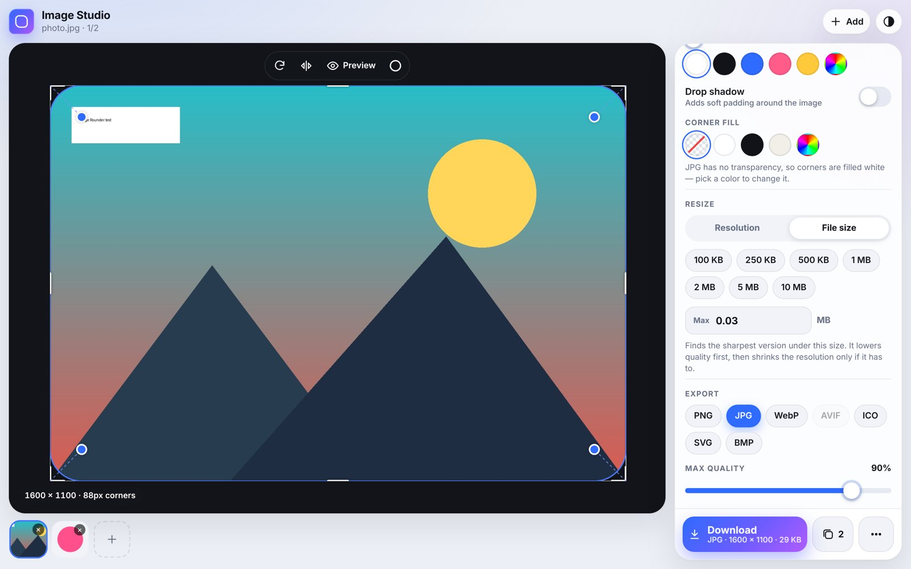
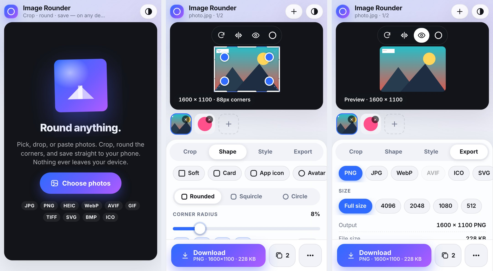

# Image Studio

Round corners, crop, resize, and compress images on any device: phone, tablet, or desktop. (Formerly *Image Rounder* + *Image Resizer*, now one app.) It works offline as an installable web app, and nothing ever leaves your device.

## What it does
- **Edit right on the image.** Drag the crop edges, corners, or the whole selection. Pull a blue corner dot to change the rounding. It snaps to square and to fully round, with a haptic tick.
- **Shapes:** Rounded, Squircle (iOS-style continuous corners), and Circle/Ellipse. You can round each corner on its own.
- **Quick styles:** Soft, Card, App icon, Avatar, Pill, Framed, Square.
- **Style:** border with a color picker, drop shadow, and a fill color for the corners (or keep them transparent).
- **Crop ratios:** Free, Original, 1:1, 4:5, 3:4, 2:3, 4:3, 3:2, 16:9, 9:16. You can also rotate and flip.
- **Batch:** open many images at once. One set of style settings applies to all of them, and each image keeps its own crop. **Save all** shares every file at once on phones, or downloads a ZIP on desktop.
- **Resize by resolution:** Original, 50%, 2×, 720p, 1080p, 2K, 4K, 8K (follows portrait/landscape), or type an exact width or height and the other side follows. Upscaling works.
- **Resize by file size:** pick 100 KB up to 10 MB (or type any size). It finds the sharpest version under that limit: it lowers quality first, then shrinks the resolution only if it has to. Works for every format except ICO.
- **Preview** shows the exact final output (tap the eye, or hold Space).

## Formats
| Open | Save |
| --- | --- |
| JPG, PNG, HEIC/HEIF, WebP, AVIF, GIF, TIFF, SVG, BMP, ICO | PNG, JPG, WebP*, AVIF*, ICO (multi-size 16–256), SVG (vector mask), BMP |

\* WebP and AVIF are offered only when the browser can encode them. The app checks this automatically.

HEIC and TIFF decoders load only when you open one of those files, so the app stays fast.

## Saving on your phone
- **iPhone/iPad:** tap **Save to Photos**. The share sheet opens, and you pick *Save Image*. Each image is pre-rendered in the background, so the sheet opens instantly. If sharing isn't available, the image opens full screen so you can press and hold it to save.
- **Android:** tap **Save / Share**, or use the ⋯ menu to download.
- **Install it:** use *Add to Home Screen* (iOS) or *Install app* (Android/desktop Chrome). Once installed, it works offline. On Android you can also share photos *to* Image Rounder from your gallery.

## Desktop shortcuts
`Ctrl/⌘+O` open · `Ctrl/⌘+V` paste · `Ctrl/⌘+S` save · `Ctrl/⌘+Shift+S` save all · `Ctrl/⌘+C` copy · `[` `]` radius · arrows nudge the crop · `R` rotate · `F` flip · `,` `.` previous/next image · hold `Space` to preview

## Performance
- The editor draws from a downscaled copy, and redraws are batched to the screen's refresh rate.
- Exports always use the full-resolution original.
- The file-size search encodes from one rendered frame and steps by the size ratio, so it usually finishes in well under a second.
- Very large photos are fitted to the device's canvas limit (around 16.7 MP on phones) so they don't crash.

## Project layout
Static site with no build step: `index.html` (markup + styles), `app.js` (everything else), `sw.js` (offline support + share target), `vendor/` (lazy HEIC/TIFF decoders, with their licenses in `vendor/licenses`).
